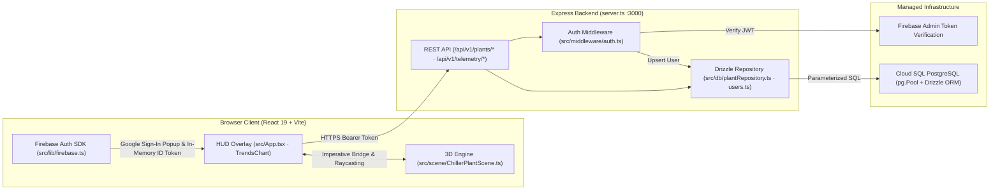

<div align="center">

# Chiller Plant Twin

**Full-Stack 3D Central HVAC Digital Twin, Real-Time Telemetry & Cloud SQL Persistence Console**

[](https://react.dev/)
[](https://www.typescriptlang.org/)
[](https://threejs.org/)
[](https://expressjs.com/)
[](https://orm.drizzle.team/)
[](https://www.postgresql.org/)
[](https://firebase.google.com/)
[](https://tailwindcss.com/)
[](https://vitejs.dev/)

<br />


</div>

---

## Overview

**Chiller Plant Twin** is a full-stack 3D industrial digital twin application for monitoring, inspecting, and persisting central chilled-water plant telemetry. It combines a procedural **Three.js** WebGL mechanical viewport and dark-room CAD HUD with an **Express + Drizzle ORM + Cloud SQL (PostgreSQL)** backend secured by **Firebase Authentication**.

### Key Capabilities

- **Procedural 3D Mechanical Plant**: Multi-part PBR models for 3 Centrifugal Chillers, 3 CHW Pumps, 3 CW Pumps, 2 Induced-Draft Cooling Towers with animated axial fans, Air Separator, Control Panel pedestal, and butterfly isolation valves.
- **Dual-Loop Piping & Animated Flow**: Sky-blue chilled water (`CHW`) and amber-orange condenser water (`CW`) header networks built with smooth `CurvePath` + `TubeGeometry` elbows and animated directional flow indicators.
- **Bidirectional Asset Inspection**: Click any unit in the **Device Tree** (`19 units`) or directly inside the **3D Viewport** via raycasting to highlight its CAD footprint and inspect live & nameplate parameters.
- **Layer Isolation & Explode Kinematics**: Toggle 8 equipment/piping/structural layers independently and smoothly separate mechanical sub-assemblies (`1.00×` – `2.50×`) using frame-rate-independent exponential damping.
- **Live Thermodynamic Scenarios & 1 Hz Trends**: Switch between `Steady State`, `Peak Cooling`, `Part Load`, and `High Wet Bulb` modes with scaled simulation speed (`×1`, `×10`, `×60`), real-time `1 Hz` SVG trend curves, and event/alarm logging.
- **Authenticated Cloud SQL Telemetry Sync**: Google Sign-In (`Firebase Auth`) issues short-lived Bearer ID tokens verified by `firebase-admin` on the Express backend to hydrate plant snapshots and persist KPI ticks, device states, time-series samples, and alarm events to PostgreSQL.

---

## Architecture

The architecture separates three runtime boundaries: the **React HUD**, the **Three.js WebGL Engine**, and the **Authenticated Express + Drizzle PostgreSQL Backend**.



### Tech Stack & Implementation Layers

| Layer | Technology | Implementation Details |
| :--- | :--- | :--- |
| **Frontend UI** | React 19, TypeScript, Tailwind CSS v4, Lucide Icons | Full-viewport CAD HUD (`Plus Jakarta Sans` + `IBM Plex Mono` `tabular-nums`) and pure SVG `TrendsChart` |
| **3D Graphics** | Three.js (`0.187`), `OrbitControls`, `RoomEnvironment` | Zero-GC animation loop, `ACESFilmicToneMapping`, `THREE.MathUtils.damp`, `isSoftwareGl` `fenceSync` guard |
| **Authentication** | Firebase Auth (`firebase`) + `firebase-admin` | Client Google Sign-In (`signInWithPopup`) with in-memory ID tokens; server Bearer verification via `requireAuth` |
| **Backend API** | Express (`4.21`), `tsx`, Vite Middleware | Serves `/api/*` routes and mounts `vite.middlewares` in dev or static `dist/` in production on port `3000` |
| **ORM & Database** | Drizzle ORM (`0.45`), `drizzle-kit`, `pg`, Cloud SQL PostgreSQL | Lazy `pg.Pool` object configuration, type-safe Drizzle queries, transactional telemetry ingestion, idempotent seeding |

### PostgreSQL Schema (`src/db/schema.ts`)

| Table | Purpose |
| :--- | :--- |
| `users` | Authenticated operator accounts mapped by Firebase `uid` |
| `plants` | Central plant registry (`code`, `name`, `timezone`) |
| `plant_devices` | Master registry for all 19 equipment units (`code`, `category`, `mesh_key`, `design_specs` JSONB) |
| `device_current_states` | Latest operational `status`, `load_pct`, `run_hours`, and `live_metrics` JSONB per unit |
| `device_telemetry_samples` | Time-series `1 Hz` readings (`load_pct`, `power_kw`, `capacity_kw`, `cop`, `chw_out_c`, `chw_in_c`, `cw_in_c`, `cw_out_c`) |
| `plant_kpi_snapshots` | Plant-wide KPI history (`cooling_load_mw`, `total_power_mw`, `system_cop`, `wet_bulb_c`, `delta_t_k`, `chillers_on`) |
| `plant_alarms` | Staging and operational event log (`severity`, `message`, `source`, `occurred_at`) |

### Backend API Endpoints (`server.ts`)

| Method & Path | Auth | Description |
| :--- | :--- | :--- |
| `GET /api/health` | Public | Stateless server liveness check |
| `GET /api/v1/plants/:plantCode/snapshot` | Bearer JWT | Idempotently seeds default plant data if empty and returns KPIs, 19 devices, trends, and alarms |
| `GET /api/v1/plants/:plantCode/devices/:deviceId/trends` | Bearer JWT | Queries historical `1 Hz` telemetry samples for the requested device |
| `POST /api/v1/telemetry/ingest` | Bearer JWT | Validates and persists KPI snapshots, device state upserts, `1 Hz` samples, and alarm entries transactionally |

---

## Project Structure

```text
.
├── server.ts                         # Express entry point (API routes + Vite dev middleware / static prod server)
├── firebase-applet-config.json       # Firebase web app & OAuth project configuration
├── index.html                        # Entry HTML, meta tags, Google Fonts (Plus Jakarta Sans & IBM Plex Mono)
├── metadata.json                     # Applet metadata & capabilities
├── package.json                      # Dependencies and npm scripts
├── tsconfig.json                     # TypeScript configuration
├── vite.config.ts                    # Vite + React + Tailwind v4 configuration
├── docs
│   └── dashboard-preview.png         # Dashboard UI & 3D viewport preview screenshot
└── src
    ├── main.tsx                      # React 19 root mount
    ├── index.css                     # Tailwind v4 import, HUD corner-bracket styles, custom slider & scrollbars
    ├── App.tsx                       # Main dashboard layout, simulation loop, Firebase Auth & API sync
    ├── components
    │   └── TrendsChart.tsx           # Live 5-minute (1 Hz) SVG multi-series trend chart & legend
    ├── data
    │   └── plantData.ts              # Initial 19-unit device tree, KPI baselines, trend seed & scenario targets
    ├── db
    │   ├── index.ts                  # pg.Pool connection pool (Object Method) & Drizzle instance
    │   ├── schema.ts                 # Drizzle PostgreSQL tables, enums, indexes & relations
    │   ├── drizzle.config.ts         # Drizzle Kit configuration (admin credentials)
    │   ├── users.ts                  # Idempotent Firebase user upsert helper
    │   └── plantRepository.ts        # Type-safe Drizzle queries, seeding & transactional telemetry ingestion
    ├── lib
    │   ├── firebase.ts               # Client Firebase App & GoogleAuthProvider initialization
    │   └── firebase-admin.ts         # Server Firebase Admin SDK initialization
    ├── middleware
    │   └── auth.ts                   # Express Bearer token verification & user sync middleware
    ├── scene
    │   └── ChillerPlantScene.ts      # Procedural 3D plant geometry, piping, flow animation, lighting & raycasting
    └── types
        └── plant.ts                  # TypeScript interfaces for devices, layers, telemetry, alarms & 3D labels
```

---

## How to Build & Run

### Prerequisites

- **Node.js** `>= 20` (or **Bun** `>= 1.1`)
- **PostgreSQL / Cloud SQL** instance & **Firebase Auth** project configured in `firebase-applet-config.json`

### Environment Variables

Runtime PostgreSQL configuration is read from server-side environment variables:

```env
SQL_HOST=<cloudsql-proxy-socket-or-host>
SQL_DB_NAME=<database-name>
SQL_USER=<app-db-user>
SQL_PASSWORD=<app-db-password>
SQL_ADMIN_USER=<admin-db-user>
SQL_ADMIN_PASSWORD=<admin-db-password>
```

### 1. Install Dependencies

```bash
npm install
# or
bun install
```

### 2. Push Drizzle Schema to PostgreSQL

```bash
npx drizzle-kit push --config=src/db/drizzle.config.ts
```

### 3. Run Development Server

Starts Express + Vite middleware on port `3000`:

```bash
npm run dev
```

Open `http://localhost:3000` in a WebGL2-capable browser.

### 4. Type-Check, Build & Start Production

```bash
# Static TypeScript verification
npm run lint

# Build frontend assets into ./dist
npm run build

# Start production Express server
NODE_ENV=production npm start
```

### Available Scripts

| Command | Description |
| :--- | :--- |
| `npm run dev` | Start Express + Vite full-stack dev server (`tsx server.ts`) at `0.0.0.0:3000` |
| `npm run start` | Run production Express server (`node server.ts`) |
| `npm run lint` | Run `tsc --noEmit` static type checking |
| `npm run build` | Bundle client production assets into `dist/` |
| `npm run preview` | Preview built frontend bundle |
| `npm run clean` | Remove `dist/` and compiled output |
