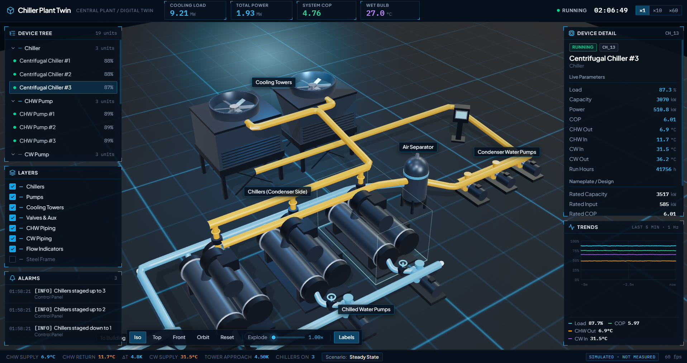
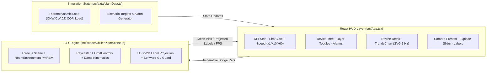

<div align="center">

# Chiller Plant Twin

**Interactive 3D Central HVAC Digital Twin & Real-Time Plant Telemetry Console**

[](https://react.dev/)
[](https://www.typescriptlang.org/)
[](https://threejs.org/)
[](https://tailwindcss.com/)
[](https://vitejs.dev/)

<br />



</div>

---

## Overview

**Chiller Plant Twin** is a browser-based 3D industrial digital twin dashboard for monitoring and inspecting a central chilled-water plant. It pairs a procedural Three.js WebGL mechanical scene with a dark-room CAD telemetry HUD, live 1 Hz thermodynamic simulation, bidirectional device picking, and interactive assembly inspection.

### Key Capabilities

- **Procedural 3D Mechanical Plant**: Multi-part PBR models for 3 Centrifugal Chillers, 3 CHW Pumps, 3 CW Pumps, 2 Induced-Draft Cooling Towers with animated axial fans, Air Separator, Control Panel pedestal, and butterfly isolation valves.
- **Dual-Loop Piping & Animated Flow**: Sky-blue chilled water (`CHW`) and amber-orange condenser water (`CW`) header networks built with smooth `CurvePath` + `TubeGeometry` elbows and animated directional flow indicators.
- **Bidirectional Asset Inspection**: Click any unit in the **Device Tree** (`19 units`) or directly inside the **3D Viewport** via raycasting to highlight its CAD footprint and inspect live & nameplate parameters.
- **Layer Isolation & Explode Kinematics**: Toggle 8 equipment/piping/structural layers independently and smoothly separate mechanical sub-assemblies (`1.00×` – `2.50×`) using frame-rate-independent exponential damping.
- **Live Thermodynamic Scenarios**: Switch between `Steady State`, `Peak Cooling`, `Part Load`, and `High Wet Bulb` modes with scaled simulation speed (`×1`, `×10`, `×60`), live `1 Hz` SVG trend curves, and automated alarm logging.

---

## Architecture

The application decouples React UI state from the WebGL render loop so HUD updates never tear down or re-initialize the Three.js canvas.



### Rendering & Performance Design

| Layer | Implementation | Purpose |
| :--- | :--- | :--- |
| **3D Engine** | `ChillerPlantScene` class mounted into an isolated `useRef` container | Prevents React re-renders from recreating the `WebGLRenderer` |
| **Materials & IBL** | `MeshStandardMaterial` + `RoomEnvironment` PMREM + `ACESFilmicToneMapping` | Realistic metallic/painted steel reflections with zero external asset 404s |
| **Render Loop** | Pre-allocated math vectors/quaternions + `THREE.MathUtils.damp` | Zero garbage collection in animation frames and smooth camera/explode motion |
| **Compatibility** | GPU probe (`isSoftwareGl`) with `gl.fenceSync` (`afterDraw`) pacing | Keeps frame pacing responsive on both hardware GPUs and software WebGL |
| **2D Telemetry** | Pure SVG `TrendsChart` + `IBM Plex Mono` (`tabular-nums`) | Razor-sharp curves and flicker-free numeric alignment |

---

## Project Structure

```text
.
├── index.html                      # Entry HTML, meta tags, Google Fonts (Plus Jakarta Sans & IBM Plex Mono)
├── metadata.json                   # Applet metadata & capabilities
├── package.json                    # Dependencies and npm scripts
├── tsconfig.json                   # TypeScript configuration
├── vite.config.ts                  # Vite + React + Tailwind v4 configuration
├── docs
│   └── dashboard-preview.png       # Dashboard UI & 3D viewport preview screenshot
└── src
    ├── main.tsx                    # React 19 root mount
    ├── index.css                   # Tailwind v4 import, HUD corner-bracket styles, custom slider & scrollbars
    ├── App.tsx                     # Main dashboard layout, simulation loop, and 3D scene bridge
    ├── components
    │   └── TrendsChart.tsx         # Live 5-minute (1 Hz) SVG multi-series trend chart & legend
    ├── data
    │   └── plantData.ts            # Initial 19-unit device tree, KPI baselines, trend seed & scenario targets
    ├── scene
    │   └── ChillerPlantScene.ts    # Procedural 3D plant geometry, piping, flow animation, lighting & raycasting
    └── types
        └── plant.ts                # TypeScript interfaces for devices, layers, telemetry, alarms & 3D labels
```

---

## How to Build

### Prerequisites

- **Node.js** `>= 20` (or **Bun** `>= 1.1`)
- **npm** / **bun**

### 1. Install Dependencies

```bash
npm install
# or
bun install
```

### 2. Run Development Server

Starts Vite on port `3000`:

```bash
npm run dev
```

Open `http://localhost:3000` in a WebGL2-capable browser.

### 3. Type-Check & Build for Production

```bash
# Run TypeScript type verification
npm run lint

# Create optimized production bundle in ./dist
npm run build
```

### 4. Preview Production Bundle

```bash
npm run preview
```

### Available Scripts

| Command | Description |
| :--- | :--- |
| `npm run dev` | Start Vite dev server at `0.0.0.0:3000` |
| `npm run lint` | Run `tsc --noEmit` static type checking |
| `npm run build` | Bundle production assets into `dist/` |
| `npm run preview` | Serve the production `dist/` build locally |
| `npm run clean` | Remove `dist/` and compiled output |
