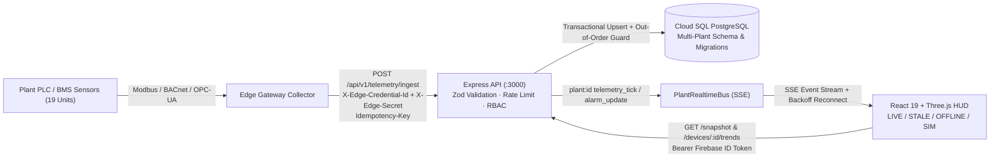

<div align="center">

# Chiller Plant Twin

**Production-Hardened 3D Central HVAC Digital Twin, Real-Time SSE Telemetry & Cloud SQL Persistence Console**

[](https://react.dev/)
[](https://www.typescriptlang.org/)
[](https://threejs.org/)
[](https://expressjs.com/)
[](https://orm.drizzle.team/)
[](https://www.postgresql.org/)
[](https://firebase.google.com/)
[](https://tailwindcss.com/)
[](https://vitejs.dev/)

<br />


</div>

---

## Overview

**Chiller Plant Twin** is a full-stack industrial digital twin application for monitoring, inspecting, and persisting central chilled-water plant telemetry. It pairs a procedural **Three.js** WebGL mechanical viewport and dark-room CAD HUD with a hardened **Express + Drizzle ORM + Cloud SQL (PostgreSQL)** backend featuring separated **Edge Gateway Ingestion Auth** and **Firebase Operator RBAC**, transactional idempotent batch persistence, and real-time **Server-Sent Events (SSE)** updates.

### Operational Modes: Live vs Simulated

The dashboard explicitly separates production telemetry from demo simulation:

| Mode | Data Source | Footer Status Pill | Purpose |
| :--- | :--- | :--- | :--- |
| **LIVE** | Cloud SQL snapshot + authenticated SSE stream (`/api/v1/plants/:plantCode/stream`) | `LIVE · <age>` / `STALE · <age>` / `OFFLINE` | Real sensor telemetry with `observedAt` freshness tracking, device-specific trends, and operator alarm ack/clear |
| **SIM** | Client thermodynamic demo engine (`SCENARIO_TARGETS`) | `SIMULATED · DEMO TICK` | Offline/anonymous visualization and what-if scenario exploration (`Steady State`, `Peak Cooling`, `Part Load`, `High Wet Bulb`) |

---

## Live Telemetry Architecture



---

## Security & Authorization Model

1. **Separated Machine vs. Human Auth**:
   - **Edge Gateways** authenticate to `POST /api/v1/telemetry/ingest` exclusively via rotatable `X-Edge-Credential-Id` + `X-Edge-Secret` headers (`scrypt` + `timingSafeEqual` verified against `edge_credentials`), bound strictly to a single `plant_id` and `edge_device_id`.
   - **Human Operators** authenticate via Firebase ID tokens (`Authorization: Bearer <token>`), authorized by centralized per-plant RBAC (`VIEWER` < `OPERATOR` < `ADMIN`) in `user_plant_roles`.
2. **Cross-Plant Tenant Isolation**:
   - Every snapshot, stream, trend, alarm, credential, and ingestion query validates `plant_id` ownership (`plant -> device -> telemetry`) with composite unique constraints (`(plant_id, device_key)` and `(plant_id, code)`).
3. **Out-of-Order & Idempotent Ingestion**:
   - Retries with the same `Idempotency-Key` (or `batchId`) safely deduplicate against `telemetry_batches`.
   - Late/out-of-order packets (`observedAt` / `sequenceNumber` older than `device_current_states.source_timestamp`) are archived in `device_telemetry_samples` without overwriting fresher live device states.

---

## API & OpenAPI Documentation

Live OpenAPI 3.1 specification is committed at [`docs/openapi.json`](docs/openapi.json) and served at runtime via:

```text
GET /api/docs/openapi.json
```

| Endpoint | Auth | Role / Scope | Description |
| :--- | :--- | :--- | :--- |
| `GET /api/health` | Public | — | Process liveness probe (zero DB dependency) |
| `GET /api/ready` | Public | — | Readiness probe verifying `pg.Pool` (`SELECT 1`) + Firebase Admin SDK |
| `GET /api/metrics` | Bearer JWT / `X-Metrics-Token` | Operator | Request, ingestion latency, deduplication, and SSE client counters |
| `GET /api/docs/openapi.json` | Public | — | OpenAPI 3.1 JSON schema |
| `GET /api/v1/plants/:plantCode/snapshot` | Bearer JWT | `VIEWER` | Full plant KPIs, 19 devices, active/recent alarms, initial trends, `observedAt` |
| `GET /api/v1/plants/:plantCode/stream` | Bearer JWT | `VIEWER` | SSE live telemetry & alarm stream (15s keepalive ping) |
| `GET /api/v1/plants/:plantCode/devices/:deviceId/trends` | Bearer JWT | `VIEWER` | Plant-isolated `1 Hz` sample history for a single device |
| `GET /api/v1/plants/:plantCode/alarms` | Bearer JWT | `VIEWER` | Plant alarm history with `EDGE` / `SYSTEM` source & ack state |
| `POST /api/v1/plants/:plantCode/alarms/:alarmId/acknowledge` | Bearer JWT | `OPERATOR` | Acknowledge alarm with operator email & timestamp audit |
| `POST /api/v1/plants/:plantCode/alarms/:alarmId/clear` | Bearer JWT | `OPERATOR` | Clear alarm with operator audit |
| `GET /api/v1/plants/:plantCode/edge-credentials` | Bearer JWT | `ADMIN` | List edge gateway credentials metadata |
| `POST /api/v1/plants/:plantCode/edge-credentials` | Bearer JWT | `ADMIN` | Issue or rotate an edge credential (returns one-time raw secret) |
| `POST /api/v1/plants/:plantCode/members` | Bearer JWT | `ADMIN` | Assign or update operator role (`VIEWER` / `OPERATOR` / `ADMIN`) |
| `POST /api/v1/telemetry/ingest` | Edge Headers | Active Edge Key | Transactional multi-device telemetry + alarm ingestion |

---

## Environment Variables

Store production secrets in **Google Secret Manager / Cloud Run Secrets**—never commit `.env` files or credentials.

| Variable | Required | Default | Description |
| :--- | :--- | :--- | :--- |
| `PORT` | No | `3000` | HTTP listen port |
| `NODE_ENV` | Yes (prod) | `development` | Enables static `dist/` serving & HSTS header in `production` |
| `APP_URL` | Yes | — | Public HTTPS origin allowed by CORS |
| `ALLOWED_ORIGINS` | No | `""` | Comma-separated additional allowed CORS origins |
| `SQL_HOST` | Yes | — | Cloud SQL Unix socket (`/cloudsql/PROJECT:REGION:INSTANCE`) or IP/host |
| `SQL_PORT` | No | `5432` | PostgreSQL TCP port (omit for Unix sockets) |
| `SQL_DB_NAME` | Yes | `chiller_plant_twin` | Target PostgreSQL database name |
| `SQL_USER` | Yes | — | Least-privilege runtime DB user (`SELECT`, `INSERT`, `UPDATE`, `DELETE`) |
| `SQL_PASSWORD` | Yes | — | Runtime DB user password |
| `SQL_SSL` | No | `false` | Enable TLS (`true` when connecting over public/VPC TCP without Cloud SQL socket) |
| `SQL_SSL_REJECT_UNAUTHORIZED` | No | `true` | Verify server TLS certificate |
| `SQL_POOL_MAX` | No | `10` | Maximum `pg.Pool` connections per server instance |
| `SQL_ADMIN_USER` | Migration only | — | Privileged DB user used strictly by `db:migrate` / `drizzle-kit` |
| `SQL_ADMIN_PASSWORD` | Migration only | — | Admin DB password used strictly for migrations |
| `BOOTSTRAP_ADMIN_EMAIL` | No | `""` | Email auto-assigned `ADMIN` role on first sign-in |
| `TELEMETRY_STALE_AFTER_SEC` | No | `15` | Age threshold (seconds) after which live UI marks telemetry `STALE` |
| `API_RATE_LIMIT_PER_MIN` | No | `180` | Per-IP rate limit on operator API endpoints |
| `INGEST_RATE_LIMIT_PER_MIN` | No | `240` | Per-credential rate limit on `/api/v1/telemetry/ingest` |
| `METRICS_TOKEN` | No | `""` | Optional static secret for `X-Metrics-Token` scraping |

---

## Local Setup, Migrations & Edge Ingestion

### 1. Install Dependencies & Apply Reproducible Migrations

```bash
npm install
npm run db:migrate
npm run db:seed
```

### 2. Create an Edge Gateway Credential

Issue a rotatable credential bound to `CENTRAL_PLANT_01` and edge gateway `gw-central-01`:

```bash
npm run edge:create-credential -- --plant CENTRAL_PLANT_01 --edge gw-central-01 --label "Main BMS Gateway"
```

Save the printed `credentialId` (`edge_...`) and one-time `secret` (`cp_edge_...`) into your edge collector's secret store.

### 3. Sample `POST /api/v1/telemetry/ingest` Request

```bash
curl -X POST http://localhost:3000/api/v1/telemetry/ingest \
  -H "Content-Type: application/json" \
  -H "X-Edge-Credential-Id: edge_your_credential_id" \
  -H "X-Edge-Secret: cp_edge_your_secret" \
  -H "Idempotency-Key: gw-central-01-seq-420" \
  -d '{
    "plantCode": "CENTRAL_PLANT_01",
    "edgeDeviceId": "gw-central-01",
    "sequenceNumber": 420,
    "payloadVersion": "1.0.0",
    "observedAt": "2026-11-21T12:00:00.000Z",
    "scenario": "Steady State",
    "quality": "GOOD",
    "kpis": {
      "coolingLoadMw": 9.35,
      "totalPowerMw": 1.96,
      "systemCop": 4.77,
      "wetBulbC": 27.1,
      "chwSupplyC": 6.8,
      "chwReturnC": 11.8,
      "deltaTK": 5.0,
      "cwSupplyC": 31.4,
      "towerApproachK": 4.3,
      "chillersOn": 3
    },
    "devices": [
      {
        "id": "ch-1",
        "status": "RUNNING",
        "quality": "GOOD",
        "loadPct": 88.2,
        "runHours": 42605,
        "metrics": { "Load": 88.2, "Capacity": 3102, "Power": 514.0, "COP": 6.03, "CHW Out": 6.8, "CW In": 31.4 }
      }
    ],
    "alarms": []
  }'
```

### 4. Run, Test & Build

```bash
# Development server (Express + Vite HMR on :3000)
npm run dev

# Static type-check + Vitest unit/integration suite
npm run lint
npm test

# Production build & start
npm run build
NODE_ENV=production npm start

# Assign operator RBAC role via CLI (after operator signs in once)
npm run plant:assign-role -- --plant CENTRAL_PLANT_01 --email operator@example.com --role OPERATOR
```

---

## Project Structure

```text
.
├── .github/workflows/ci.yml          # CI: lint, drizzle-kit check, Postgres migrate, vitest, build
├── Dockerfile                        # Non-root Node 22 multi-stage Cloud Run image
├── deploy/
│   └── cloudrun.service.yaml         # Declarative Cloud Run service manifest (maxScale=1, probes, Secret refs)
├── docs/
│   ├── dashboard-preview.png         # Dashboard HUD preview screenshot
│   └── openapi.json                  # OpenAPI 3.1 API specification
├── drizzle/                          # Committed Drizzle SQL migration history
├── server.ts                         # Production/dev server entrypoint + graceful shutdown
└── src/
    ├── App.tsx                       # Live vs Simulated HUD, SSE client, freshness & alarm lifecycle UI
    ├── components/TrendsChart.tsx    # Pure SVG 1 Hz multi-series trend chart + loading/empty states
    ├── db/
    │   ├── index.ts                  # pg.Pool connection & closePool()
    │   ├── schema.ts                 # Multi-plant Drizzle PostgreSQL schema
    │   ├── plantRepository.ts        # Transactional ingest, out-of-order guard, RBAC & trend queries
    │   ├── migrate.ts                # Admin migration runner
    │   └── seed.ts                   # Controlled dev seed CLI
    ├── lib/
    │   ├── edgeCrypto.ts             # scrypt + timingSafeEqual edge credential cryptography
    │   ├── logger.ts                 # Structured JSON logger with secret redaction
    │   ├── metrics.ts                # HTTP, ingest & SSE operational metrics
    │   └── realtimeBus.ts            # Plant-scoped SSE EventEmitter bus
    ├── middleware/
    │   ├── auth.ts                   # Separated operator RBAC & edge gateway authentication
    │   └── security.ts               # Request ID, security headers, restricted CORS, rate limiter
    ├── scene/ChillerPlantScene.ts    # Procedural Three.js 3D plant scene
    ├── scripts/
    │   ├── assignPlantRole.ts        # CLI to assign per-plant VIEWER/OPERATOR/ADMIN roles
    │   └── createEdgeCredential.ts   # CLI to issue/rotate edge gateway credentials
    ├── server/app.ts                 # Testable Express application factory
    └── validation/telemetrySchemas.ts # Strict Zod contracts
```

---

## Pilot Limitations & Operational Runbooks

### Pilot Boundaries
- **Single-Instance SSE Bus**: `PlantRealtimeBus` is an in-memory Node `EventEmitter`. On Cloud Run, run with `--max-instances=1` (or back `realtimeBus` with PostgreSQL `LISTEN/NOTIFY` or Redis Pub/Sub before scaling horizontally).
- **Time-Series Retention**: `device_telemetry_samples` stores raw `1 Hz` rows; add PostgreSQL monthly range partitioning or scheduled archival before multi-year high-frequency retention.

### Quick Runbook

| Symptom | Check | Resolution |
| :--- | :--- | :--- |
| Dashboard shows `OFFLINE` | Check `GET /api/ready` and Cloud Run logs (`requestId`) | Verify Firebase OAuth domain / Cloud SQL connectivity; click **Retry** |
| Dashboard shows `STALE` | Compare `observedAt` vs `TELEMETRY_STALE_AFTER_SEC` | Check edge collector uptime and `POST /api/v1/telemetry/ingest` logs (`401`/`429`) |
| Edge receives `401` / `403` | Inspect `edge_credentials` status & `plantCode` | Rotate credential via `npm run edge:create-credential` and update gateway secret |
| Deployment readiness `503` | Inspect `/api/ready` checks (`database`, `auth`) | Confirm Cloud SQL connector / `SQL_HOST` and least-privilege `SQL_USER` grant |
