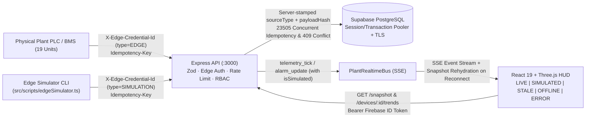

<div align="center">

# Chiller Plant Twin

**Production-Hardened 3D Central HVAC Digital Twin, Real-Time SSE Telemetry & Supabase PostgreSQL Console**

[](https://react.dev/)
[](https://www.typescriptlang.org/)
[](https://threejs.org/)
[](https://expressjs.com/)
[](https://orm.drizzle.team/)
[](https://supabase.com/)
[](https://firebase.google.com/)
[](https://bun.sh/)

<br />


</div>

---

## Overview

**Chiller Plant Twin** is a full-stack industrial digital twin for central chilled-water plant monitoring. It combines a procedural **Three.js** WebGL mechanical scene and dark-room CAD HUD with a hardened **Express + Drizzle ORM + Supabase PostgreSQL** backend featuring separated **Edge Gateway Ingestion Auth** (`EDGE` vs `SIMULATION` provenance) and **Firebase Operator RBAC**, concurrent-safe idempotent ingestion, out-of-order telemetry guards, and live **Server-Sent Events (SSE)** streaming.

### Operational & Provenance Status Modes

Both the backend provenance ledger (`isSimulated`, `sourceType`) and the frontend HUD strictly prevent simulated or stale data from impersonating live physical telemetry:

| HUD Badge | Condition / Data Source | Behavior |
| :--- | :--- | :--- |
| **`LIVE · <age>`** | Authenticated operator stream receiving fresh packets from an **`EDGE`** credential (`isSimulated=false`, age ≤ `TELEMETRY_STALE_AFTER_SEC`) | Displays live KPIs, all 19 units, and 1 Hz device trends |
| **`SIMULATED · EDGE SIM / SEEDED / LOCAL DEMO`** | Either local **SIM** mode OR backend stream fed by a **`SIMULATION`** edge credential / dev **`SEED`** (`isSimulated=true`) | Never displays `LIVE`; clearly tags simulated provenance |
| **`STALE · <age>`** | `observedAt` age exceeds `TELEMETRY_STALE_AFTER_SEC` or SSE is reconnecting | Dims KPIs and displays sensor reading age |
| **`OFFLINE`** | Operator signed out or SSE stream disconnected after retries | Masks KPIs (`—`) and shows retry banner |
| **`ERROR`** | Backend `/snapshot` or API returned an error (`401`/`403`/`500`/network failure) | Masks KPIs (`—`) and presents Retry / Demo Mode actions |

---

## Live vs Simulated Data Flow



---

## Security & Data Integrity Model

1. **Separated Machine vs. Human Auth**:
   - **Edge Gateways & Simulators** authenticate only to `POST /api/v1/telemetry/ingest` using rotatable `X-Edge-Credential-Id` + `X-Edge-Secret` (`scrypt` + `timingSafeEqual` against `edge_credentials`). Credentials carry a server-enforced `credentialType` (`EDGE` or `SIMULATION`) — the server ignores any client claim about simulation status.
   - **Operators** authenticate via Firebase ID tokens (`Authorization: Bearer <token>`), authorized per plant (`VIEWER` < `OPERATOR` < `ADMIN`) via centralized `requirePlantRole()` middleware.
   - Supabase `service_role` keys and database passwords are **never** placed in browser `VITE_*` variables or committed to git.
2. **Concurrent & Retry-Safe Idempotency**:
   - Batches require an `Idempotency-Key` (or `batchId`) guarded by a composite unique index `(plant_id, edge_device_id, idempotency_key)` and canonical SHA-256 `payload_hash` on `telemetry_batches`.
   - Sequential and parallel concurrent retries with identical payload safely return `{ deduplicated: true }` without double-inserting samples or KPIs.
   - Reusing an existing `Idempotency-Key` with a **modified payload** is rejected with **`409 IDEMPOTENCY_CONFLICT`**.
3. **Out-of-Order & Cross-Plant Protection**:
   - Every table scopes devices, samples, KPIs, and alarms by `plant_id`.
   - `isNewerReading(incomingTs, sequenceNumber, currentTs, currentSeq)` prevents delayed packets from overwriting fresher `device_current_states` or KPI snapshots while still archiving historical samples for all 19 devices.
   - `received_at` is assigned exclusively by the API server.

---

## Supabase PostgreSQL Setup & Environment Variables

Copy [`.env.example`](.env.example) to `.env` (gitignored via `.gitignore` and excluded from container images via `.dockerignore`):

| Variable | Required | Default | Description |
| :--- | :--- | :--- | :--- |
| `SUPABASE_DB_URL` | Recommended | `""` | Supabase Pooler connection string (`postgresql://postgres.<ref>:<pass>@aws-1-...pooler.supabase.com:5432/postgres` for Session Pooler or `:6543` for Transaction Pooler) |
| `SUPABASE_ADMIN_DB_URL` | Migration only | `""` | Optional privileged DB URL used by `db:migrate` / `drizzle-kit` |
| `SQL_HOST` / `SQL_PORT` / `SQL_DB_NAME` / `SQL_USER` / `SQL_PASSWORD` | Fallback | `5432` / `postgres` | Split PostgreSQL vars supported when `SUPABASE_DB_URL` is unset |
| `SQL_ADMIN_USER` / `SQL_ADMIN_PASSWORD` | Fallback migration | — | Split admin credentials for `db:migrate` |
| `SQL_SSL` | Yes (Supabase) | `true` | Enables TLS for `pg.Pool` and `drizzle-kit` |
| `SQL_SSL_REJECT_UNAUTHORIZED` | No | `true` | Verifies TLS server certificate; set `"false"` only if connecting without Root CA PEM |
| `SQL_SSL_CA` | Recommended | `""` | Path to Supabase Root CA `.crt`/`.pem` or inline PEM string (`BEGIN CERTIFICATE`) |
| `SQL_POOL_MAX` | No | `10` | Max connections in `pg.Pool` |
| `PORT` / `NODE_ENV` / `APP_URL` | Yes | `3000` / `development` | HTTP port, runtime mode, and allowed CORS origin |
| `BOOTSTRAP_ADMIN_EMAIL` | Production | `""` | Operator email auto-bootstrapped as `ADMIN` on `CENTRAL_PLANT_01` |
| `TELEMETRY_STALE_AFTER_SEC` | No | `15` | Seconds after `observedAt` before HUD marks stream `STALE` |
| `EDGE_API_URL` / `PLANT_CODE` / `EDGE_CREDENTIAL_ID` / `EDGE_SECRET` | Simulator CLI | — | Used by `src/scripts/edgeSimulator.ts` (never store secrets in git) |

> **Pooler Guidance**: Use Supabase **Session Pooler (`:5432`)** for stateful servers (`server.ts`) and migrations (`db:migrate`), or **Transaction Pooler (`:6543`)** when sharing connections across serverless workers.

---

## Local Setup, Migrations, Credentials & Edge Simulator

### 1. Install Dependencies & Apply Supabase Migrations

This repository standardizes on **Bun** (`bun.lock`) with **Node 22** runtime compatibility (`node server.ts`):

```bash
cp .env.example .env
# Populate SUPABASE_DB_URL (or SQL_HOST / SQL_USER / SQL_PASSWORD / SQL_SSL)

bun install --frozen-lockfile
bunx drizzle-kit check --config=src/db/drizzle.config.ts
bun run db:migrate

# Development-only initial dataset (tags rows with sourceType='SEED', isSimulated=true)
bun run db:seed
```

### 2. Issue Edge Credentials (`EDGE` vs `SIMULATION`)

Issue a **simulator** credential (server automatically tags ingested batches as `sourceType='SIMULATION'`, `isSimulated=true`):

```bash
bun run edge:create-credential -- \
  --plant CENTRAL_PLANT_01 \
  --edge gw-sim-01 \
  --type SIMULATION \
  --label "Local Edge Simulator"
```

Or issue a **production gateway** credential (`--type EDGE`, default):

```bash
bun run edge:create-credential -- \
  --plant CENTRAL_PLANT_01 \
  --edge gw-central-01 \
  --type EDGE \
  --label "Main BMS PLC Gateway"
```

### 3. Run the Edge Gateway Simulator CLI

Start the Express backend (`bun run dev` or `NODE_ENV=production node server.ts`), then run the simulator in another terminal so dummy data travels through `/api/v1/telemetry/ingest`:

```bash
export EDGE_API_URL="http://127.0.0.1:3000"
export PLANT_CODE="CENTRAL_PLANT_01"
export EDGE_CREDENTIAL_ID="edge_..."
export EDGE_SECRET="cp_edge_..."

# Steady state stream every 2s (all 19 devices, deterministic seed)
bun run edge:simulator -- --mode steady --interval-ms 2000 --seed 42

# Other scenarios: peak | part-load | high-wet-bulb, finite loops example:
bun run edge:simulator -- --mode peak --interval-ms 1500 --loops 10 --seed 101
```

Stop the simulator (`Ctrl+C`) and wait `> TELEMETRY_STALE_AFTER_SEC` (`15s`) to verify the dashboard transitions cleanly from `SIMULATED · EDGE SIM` -> `STALE`.

---

## API Examples (`curl`)

Full OpenAPI 3.1 schema is served at `GET /api/docs/openapi.json` (source: [`docs/openapi.json`](docs/openapi.json)).

### Create/Rotate Edge Credential (Admin Bearer Token)

```bash
curl -X POST http://127.0.0.1:3000/api/v1/plants/CENTRAL_PLANT_01/edge-credentials \
  -H "Authorization: Bearer <FIREBASE_ID_TOKEN>" \
  -H "Content-Type: application/json" \
  -d '{
    "edgeDeviceId": "gw-central-01",
    "label": "BMS Gateway #1",
    "credentialType": "EDGE",
    "expiresInDays": 90
  }'
```

### Ingest Batch (`POST /api/v1/telemetry/ingest`)

```bash
curl -X POST http://127.0.0.1:3000/api/v1/telemetry/ingest \
  -H "Content-Type: application/json" \
  -H "X-Edge-Credential-Id: $EDGE_CREDENTIAL_ID" \
  -H "X-Edge-Secret: $EDGE_SECRET" \
  -H "Idempotency-Key: gw-central-01-seq-420" \
  -d '{
    "plantCode": "CENTRAL_PLANT_01",
    "edgeDeviceId": "gw-central-01",
    "sequenceNumber": 420,
    "payloadVersion": "1.0.0",
    "observedAt": "2026-11-21T12:00:00.000Z",
    "scenario": "Steady State",
    "quality": "GOOD",
    "kpis": {
      "coolingLoadMw": 9.35, "totalPowerMw": 1.96, "systemCop": 4.77,
      "wetBulbC": 27.1, "chwSupplyC": 6.8, "chwReturnC": 11.8,
      "deltaTK": 5.0, "cwSupplyC": 31.4, "towerApproachK": 4.3, "chillersOn": 3
    },
    "devices": [
      {
        "id": "ch-1",
        "status": "RUNNING",
        "quality": "GOOD",
        "loadPct": 88.2,
        "runHours": 42605,
        "metrics": { "Load": 88.2, "Capacity": 3102, "Power": 514.0, "COP": 6.03, "CHW Out": 6.8, "CW In": 31.4 }
      }
    ]
  }'
```

### Fetch Plant Snapshot & Subscribe to SSE Stream

```bash
# Hydrate KPIs, all 19 devices, alarms, trends, and provenance (isSimulated, sourceType, observedAt)
curl -H "Authorization: Bearer <FIREBASE_ID_TOKEN>" \
  http://127.0.0.1:3000/api/v1/plants/CENTRAL_PLANT_01/snapshot

# Subscribe to live plant SSE stream
curl -N -H "Authorization: Bearer <FIREBASE_ID_TOKEN>" \
  -H "Accept: text/event-stream" \
  http://127.0.0.1:3000/api/v1/plants/CENTRAL_PLANT_01/stream
```

---

## Testing, Docker & Production Deployment

### Verification Commands

```bash
bun run lint
bunx drizzle-kit check --config=src/db/drizzle.config.ts
bun run test
bun run build
NODE_ENV=production node server.ts
```

### Docker Build & Run (Bun + Node 22 Non-Root Image)

[`Dockerfile`](Dockerfile) installs frozen dependencies using `bun.lock`, compiles the TypeScript/Vite bundle, strips devDependencies, and runs `node server.ts` as non-root `appuser` without `.env` or secret files inside the image:

```bash
docker build -t chiller-plant-twin:latest .
docker run --rm -p 3000:3000 --env-file .env chiller-plant-twin:latest
```

### Cloud Run Deployment

[`deploy/cloudrun.service.yaml`](deploy/cloudrun.service.yaml) targets Supabase PostgreSQL via Secret Manager (`chiller-supabase-db-url`, `chiller-supabase-root-ca`) with zero Cloud SQL socket dependencies.

---

## Pilot Boundaries, Troubleshooting & Scale-Out Roadmap

### Pilot Boundaries
- **Single-Instance SSE Bus**: `PlantRealtimeBus` currently uses an in-process Node `EventEmitter`. Keep `maxScale: "1"` in [`deploy/cloudrun.service.yaml`](deploy/cloudrun.service.yaml) during pilot deployments.
- **Scale-Out Path**: Before enabling horizontal autoscaling (`maxScale > 1`), replace `PlantRealtimeBus.publish/subscribe` with **Supabase Realtime Broadcast**, PostgreSQL **`LISTEN/NOTIFY`**, or **Redis Pub/Sub**, and add monthly range partitioning on `device_telemetry_samples`.

### Troubleshooting

| Symptom | Cause | Resolution |
| :--- | :--- | :--- |
| `SELF_SIGNED_CERT_IN_CHAIN` connecting to Supabase | Missing Supabase Root CA when `SQL_SSL_REJECT_UNAUTHORIZED="true"` | Download the Supabase CA cert and set `SQL_SSL_CA=/path/to/supabase-ca.crt` (only use `"false"` for local testing) |
| `409 IDEMPOTENCY_CONFLICT` on ingest | `Idempotency-Key` reused with altered payload | Use a unique `Idempotency-Key` per new batch; only reuse the exact key when retrying the identical payload |
| HUD stays `SIMULATED · EDGE SIM` | Gateway uses a `credentialType: 'SIMULATION'` key | Expected behavior; issue a `--type EDGE` credential for physical plant PLCs |
| HUD shows `STALE` or `OFFLINE` | Gateway stopped > 15s or stream dropped | Restart collector / check `/api/ready` (`database`, `auth`) and gateway `401`/`429` logs |
